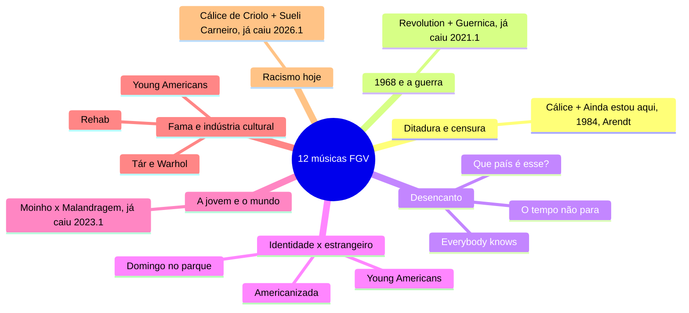

# Artes — as 12 músicas em flashcards (3 por música)

> Manhã de Artes de 12/10/2026. 36 cards: **contexto histórico · tema e crítica · conexões**.
> ⭐ = já caiu na FGV, com o id da questão no banco de provas antigas.
> Fontes: apostila v3, p. 39–50 · `musica-brasileira.md` · banco de provas antigas.
> Versão com os cards virando: `12-musicas-flashcards.html`.

**Divergência com a apostila:** ela lê *Malandragem* como desilusão amorosa. Para a prova, use a
leitura da jovem que quer viver, que é a que conversa com o Cartola (`2023.1-DIS-AR4`).

## Mapa mental

## Flashcards

Clique na pergunta para abrir a resposta.

### Com que roupa? — Noel Rosa, 1930

> [!question]- 1. “Com que roupa?”: qual era o contexto histórico?
> **Noel Rosa, 1930.**
> - **Crise de 1929**: o café despenca, desemprego.
> - **Revolução de 30**: Vargas chega ao poder.
> - O samba estava virando a música urbana do Rio, levada pelo rádio.

> [!question]- 2. “Com que roupa?”: do que trata e qual é a crítica?
> O eu lírico não tem roupa, ou seja, dinheiro, nem para ir ao samba.
> **Crítica:** a **pobreza contada com humor e ironia**. É crônica do cotidiano carioca: o sujeito pobre vira retrato do Brasil em crise.

> [!question]- 3. “Com que roupa?”: com que outras obras se conecta?
> - *Malandragem*: os dois sentidos de malandragem. Aqui, o jeito de sobreviver à pobreza.
> - *O bem-amado*: o Brasil visto com humor e crítica.
> - *Vidas secas* (1938): a pobreza no Brasil de Vargas, na cidade e no sertão.

### Disseram que voltei americanizada — Carmen Miranda, 1940

> [!question]- 4. “Disseram que voltei americanizada”: qual era o contexto histórico?
> **Carmen Miranda, 1940** (composição de Luiz Peixoto e Vicente Paiva).
> - **Estado Novo** de Vargas: nacionalismo, o samba como símbolo do país.
> - **Política da Boa Vizinhança**: na 2ª Guerra, os EUA se aproximam da América Latina, e Carmen vira a vitrine do Brasil em Hollywood.

> [!question]- 5. “Disseram que voltei americanizada”: do que trata e qual é a crítica?
> Ela volta de Hollywood, é recebida com frieza e acusada de ter se americanizado. A canção é a resposta: **continua brasileira**.
> **Crítica / debate:** **identidade nacional × estrangeiro** e o **estereótipo** (a “baiana das frutas” vendida como América Latina). A identidade não é uma pureza fixa.

> [!question]- 6. “Disseram que voltei americanizada”: com que outras obras se conecta?
> - *Manifesto Antropófago*: devorar o estrangeiro sem perder a identidade.
> - *Domingo no parque*: a Tropicália resgatou Carmen como ícone.
> - *Young Americans*: o mesmo tema pelo avesso, um inglês fazendo som americano.

### Domingo no parque — Gilberto Gil, 1967 ⭐

> [!question]- 7. “Domingo no parque”: qual era o contexto histórico?
> **Gilberto Gil com Os Mutantes, 1967**, arranjo de Rogério Duprat. 2º lugar no **Festival da Record**.
> - Ditadura militar, um ano antes do AI-5. Era dos festivais da TV.
> - No mesmo ano houve a **passeata contra a guitarra elétrica**: parte da MPB via a guitarra como invasão estrangeira.
> ⭐ `2024.1-DIS-AR3 · a Tropicália nos anos 1960`

> [!question]- 8. “Domingo no parque”: do que trata e qual é a crítica?
> José, João e Juliana: um **triângulo amoroso** num domingo de parque que acaba em **crime passional**.
> - Berimbau e capoeira da Bahia + guitarra elétrica.
> - A letra é **montada como cinema**, em cortes.
> **Crítica:** contra o purismo da MPB. Misturar nacional e estrangeiro é a **Tropicália**.

> [!question]- 9. “Domingo no parque”: com que outras obras se conecta?
> - *Manifesto Antropófago* e *Abaporu*: a Tropicália é a antropofagia de Oswald na música.
> - *Disseram que voltei americanizada*: Carmen virou ícone tropicalista.
> - *Cálice*: Gil de novo, já sob o AI-5, com prisão e exílio depois de 1968.
> ⭐ `2024.1-DIS-AR3 · Domingo no parque e a Tropicália`

### Revolution — The Beatles, 1968 ⭐

> [!question]- 10. “Revolution”: qual era o contexto histórico?
> **The Beatles, 1968** (letra de John Lennon).
> - **1968**, ano de revoltas no mundo: **Maio de 68** em Paris, **Guerra do Vietnã**, movimentos pelos direitos civis.
> - Contracultura. No Brasil, o ano do AI-5.
> ⭐ `2025.1-DIS-AR4 · Revolution à luz de 1968`

> [!question]- 11. “Revolution”: do que trata e qual é a crítica?
> Lennon diz que **quer mudar o mundo**, mas **rejeita a violência** como método e o radicalismo dogmático.
> **Crítica:** é um debate sobre os meios da transformação, **revolução × pacifismo**. Por isso foi criticada pela esquerda radical.
> Saiu em duas versões: rock com guitarra distorcida e balada.

> [!question]- 12. “Revolution”: com que outras obras se conecta?
> - *Guernica*: a FGV já cruzou as duas, no contexto político e no sentido sobre a guerra.
> - *Cálice* e *Que país é esse?*: arte e transformação social.
> - *Domingo no parque*: a contracultura dos anos 60 no Brasil.
> ⭐ `2021.1-DIS-AR4 e AR5 · Guernica × Revolution`

### Cálice — Chico Buarque e Gilberto Gil, 1973 ⭐

> [!question]- 13. “Cálice”: qual era o contexto histórico?
> **Chico Buarque e Gilberto Gil, 1973.**
> - Auge da ditadura: **governo Médici**, AI-5, anos de chumbo, censura prévia.
> - Foi **censurada**: no show Phono 73 cortaram os microfones. Só saiu em disco em 1978.

> [!question]- 14. “Cálice”: do que trata e qual é a crítica?
> O trocadilho **cálice / cale-se**. Usa a Paixão de Cristo (o pedido de afastar o cálice) para falar do sofrimento.
> **Crítica:** à **censura** e ao silêncio imposto pela repressão.
> **Criolo** (anos 2010) reescreveu em rap: periferia, racismo, violência policial. O silenciamento continua, com outros alvos.
> ⭐ `2026.1-DIS-AR1 · Cálice de Criolo`

> [!question]- 15. “Cálice”: com que outras obras se conecta?
> - **Ditadura e memória:** *Ainda estou aqui*, *Cabra marcado para morrer*, *As meninas* (também de 1973).
> - **Poder e censura:** *1984* e Arendt.
> - **Criolo + Sueli Carneiro:** o mito da democracia racial e raça × classe.
> ⭐ `2026.1-DIS-AR1 · Criolo lido com Sueli Carneiro`

### Young Americans — David Bowie, 1975

> [!question]- 16. “Young Americans”: qual era o contexto histórico?
> **David Bowie, 1975.** Inglês, o “camaleão do rock”, sempre reinventando a própria imagem.
> - Os **EUA dos anos 70**, depois das utopias dos 60: pós-**Vietnã**, pós-**Watergate**.
> - Consumo e crise do “sonho americano”.

> [!question]- 17. “Young Americans”: do que trata e qual é a crítica?
> Retrata jovens americanos e o **vazio por trás do sonho de consumo**.
> **Crítica:** à cultura americana e às ilusões da geração.
> A forma também fala: um inglês fazendo soul e funk “americano” (o *plastic soul*). O som já discute a **assimilação cultural**.

> [!question]- 18. “Young Americans”: com que outras obras se conecta?
> - *Disseram que voltei americanizada*: o mesmo tema pelo avesso.
> - Warhol (*Mao Tse Tung*) e a Pop Art: imagem e consumo.
> - *Rehab*: identidade e indústria cultural.

### O mundo é um moinho — Cartola, 1976 ⭐

> [!question]- 19. “O mundo é um moinho”: qual era o contexto histórico?
> **Cartola, 1976.** Samba-canção, samba de raiz.
> - Um dos fundadores da **Mangueira**; só gravou o primeiro disco nos anos 70, já com mais de 60 anos.
> - O país está na ditadura, mas a música não é política: é lírica.

> [!question]- 20. “O mundo é um moinho”: do que trata e qual é a crítica?
> Um mais velho aconselha uma **jovem que quer sair de casa cedo**: o mundo é um **moinho** que vai triturar os sonhos dela.
> **Crítica:** não é política. É um alerta sobre a dureza do mundo, em tom melancólico. Mostra o **samba como poesia**.
> ⭐ `2023.1-DIS-AR4 · Moinho × Malandragem`

> [!question]- 21. “O mundo é um moinho”: com que outras obras se conecta?
> - *Malandragem*: a mesma cena vista do outro lado (quem aconselha × quem quer ir). E samba de raiz × rock/MPB.
> - *Com que roupa?*: o samba como crônica e poesia popular.
> ⭐ `2023.1-DIS-AR4 · comparar Moinho e Malandragem`

### Que país é esse? — Legião Urbana, 1987

> [!question]- 22. “Que país é esse?”: qual era o contexto histórico?
> **Escrita por Renato Russo em 1978**, na ditadura, no punk de Brasília.
> **Lançada pela Legião Urbana em 1987**, na redemocratização: governo Sarney, inflação, **Constituinte**.

> [!question]- 23. “Que país é esse?”: do que trata e qual é a crítica?
> Enumera as mazelas do país: **corrupção, desigualdade, impunidade**. A pergunta do título é a denúncia.
> **Crítica:** **a ditadura acabou e o país não mudou**. A letra diz até que ninguém respeita a Constituição, e saiu enquanto a nova estava sendo escrita.

> [!question]- 24. “Que país é esse?”: com que outras obras se conecta?
> - *O tempo não para*: a dupla do desencanto dos anos 80.
> - *Revolution* e *Cálice*: arte e transformação social.
> - *O bem-amado* e *Cidade de Deus*: corrupção e desigualdade.

### O tempo não para — Cazuza, 1988

> [!question]- 25. “O tempo não para”: qual era o contexto histórico?
> **Cazuza (com Arnaldo Brandão), 1988.**
> - A Nova República frustra: Sarney, inflação, ano da Constituição.
> - Cazuza já tinha **HIV** (morreu em 1990), o que dá urgência à letra.

> [!question]- 26. “O tempo não para”: do que trata e qual é a crítica?
> Ataca a **hipocrisia** e a elite acomodada: um país que repete o velho e chama de novidade.
> **Crítica:** social + **finitude pessoal**. O tempo passa e o país não muda.

> [!question]- 27. “O tempo não para”: com que outras obras se conecta?
> - *Que país é esse?*: o desencanto dos anos 80.
> - *Everybody knows*: o mesmo ano, o mesmo cinismo, agora no mundo.
> - *Malandragem*: também de Cazuza.

### Everybody knows — Leonard Cohen, 1988

> [!question]- 28. “Everybody knows”: qual era o contexto histórico?
> **Leonard Cohen, 1988.** Poeta e cantor canadense, de letras densas.
> - Fim dos anos 80: **capitalismo global**, desigualdade, epidemia de aids, desilusão.

> [!question]- 29. “Everybody knows”: do que trata e qual é a crítica?
> O refrão repete “todo mundo sabe” e enumera **injustiças que todos aceitam**: os dados estão viciados, os ricos ganham, a aids se espalha. E tudo segue.
> **Crítica:** à **resignação** e à naturalização da injustiça, em tom grave e irônico.

> [!question]- 30. “Everybody knows”: com que outras obras se conecta?
> - *O tempo não para*: mesmo ano, mesmo desencanto.
> - *Babel*: globalização e desigualdade.
> - Sueli Carneiro: a desigualdade que se naturaliza.

### Malandragem — Cássia Eller, 1994 ⭐

> [!question]- 31. “Malandragem”: qual era o contexto histórico?
> **Cazuza e Frejat** compuseram no fim dos anos 80. Estourou na voz de **Cássia Eller, em 1994**.
> - Brasil já redemocratizado; rock e MPB dos anos 90.

> [!question]- 32. “Malandragem”: do que trata e qual é a crítica?
> A voz de uma **jovem presa à imagem de menina boazinha**, que pede um pouco de malandragem: quer experiência, liberdade, perder a inocência.
> **Crítica:** à moral que prende a jovem.
> ⚠️ A apostila lê como desilusão amorosa. Na prova, use esta leitura, que é a que conversa com o Cartola.
> ⭐ `2023.1-DIS-AR4 · Moinho × Malandragem`

> [!question]- 33. “Malandragem”: com que outras obras se conecta?
> - *O mundo é um moinho*: a mesma cena, do lado da jovem.
> - *Com que roupa?*: a malandragem dos anos 30 era sobreviver à pobreza.
> - *O tempo não para*: também de Cazuza.
> ⭐ `2023.1-DIS-AR4 · comparar Moinho e Malandragem`

### Rehab — Amy Winehouse, 2006

> [!question]- 34. “Rehab”: qual era o contexto histórico?
> **Amy Winehouse, 2006.** Britânica, soul e R&B retrô; a canção ganhou vários Grammys.
> - Cena pop dos anos 2000 e a **indústria da fama**.
> - A letra é autobiográfica.

> [!question]- 35. “Rehab”: do que trata e qual é a crítica?
> O eu lírico **recusa ir à reabilitação**: vício, autonomia e pressão da indústria.
> **Crítica:** a **fama que consome o artista**. Ironia entre o som alegre e o tema sombrio.

> [!question]- 36. “Rehab”: com que outras obras se conecta?
> - *Tár*: o artista, o poder e a queda.
> - *Young Americans*: imagem e indústria cultural.
> - Warhol (*Mao Tse Tung*): arte × mercado.

## O que já caiu na FGV (banco 2021.1–2026.1)

| Questão | Tema |
|---|---|
| `2021.1-DIS-AR4` | Contexto político de *Guernica* e de *Revolution* |
| `2021.1-DIS-AR5` | *Guernica* e *Revolution*: o sentido sobre a guerra |
| `2023.1-DIS-AR4` | Comparar *O mundo é um moinho* e *Malandragem* |
| `2024.1-DIS-AR3` | *Domingo no parque* e a Tropicália nos anos 1960 |
| `2025.1-DIS-AR4` | *Revolution* à luz de 1968 |
| `2026.1-DIS-AR1` | *Cálice* de Criolo lido com Sueli Carneiro |

## 🔗 Relacionados

[[Cursinho-projeto]]
